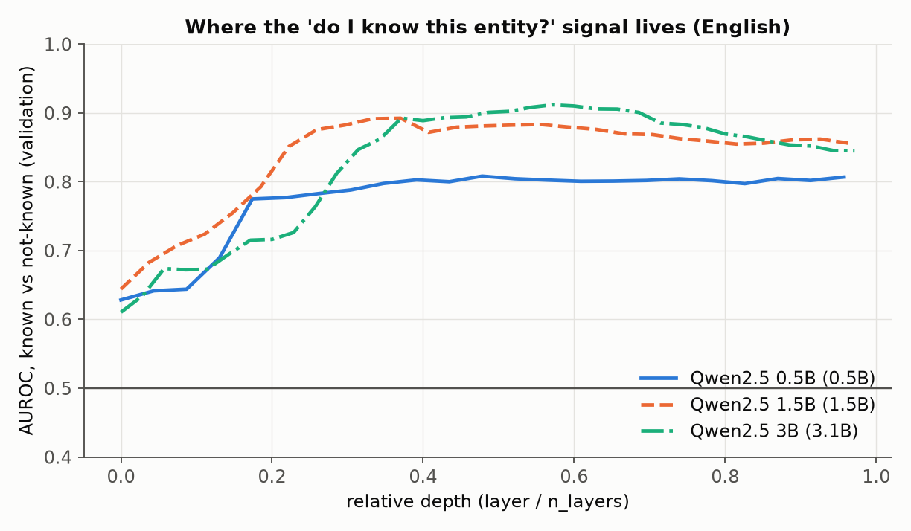
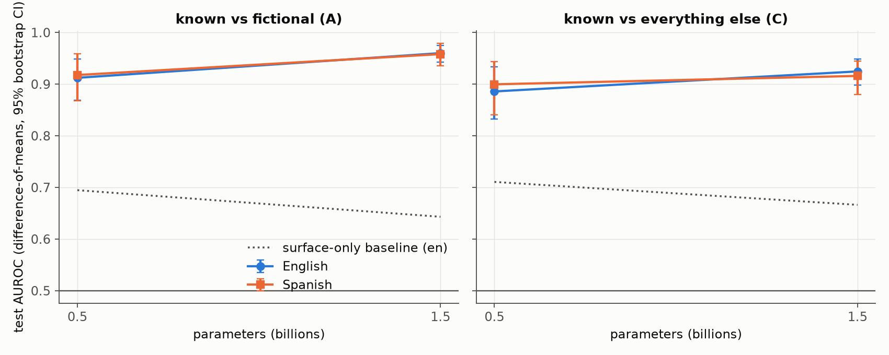
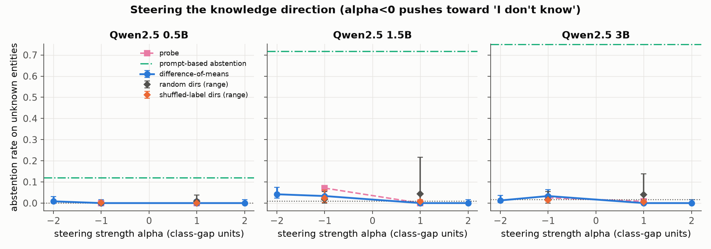
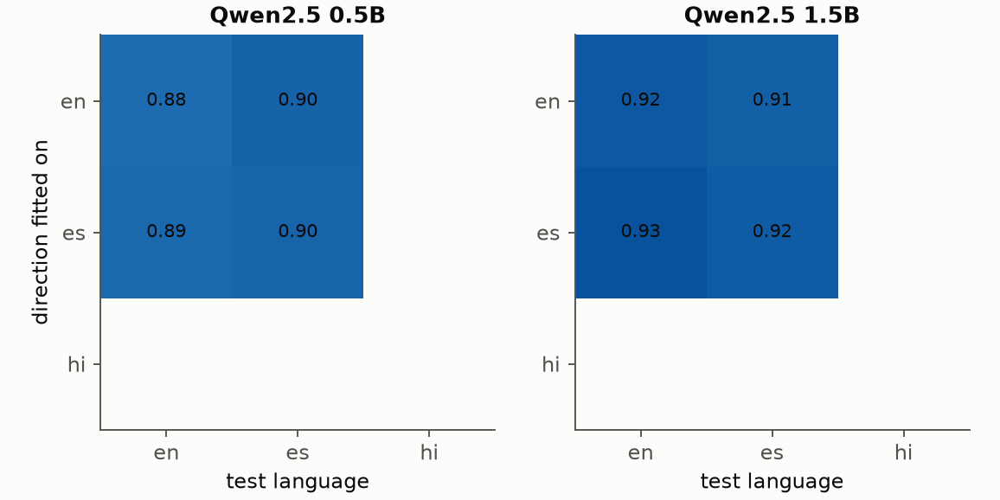

# NeuralTrace: a cross-scale, cross-lingual causal audit of "knowledge-awareness" in LLMs

Language models carry an internal signal for "I don't recognise this entity". This project asks two separate questions about it:

1. **Detection.** Can that signal be read out reliably, at which layer, at which model size, and in which language?
2. **Control.** If we push the model along that direction, does it abstain instead of hallucinating?

**Headline result.** The signal is easy to read and the model cannot be steered with it. A single linear direction in the residual stream separates entities the model answers correctly from those it does not (AUROC 0.89 to 0.94 for known-vs-everything-else; 0.91 to 0.97 for known-vs-fictional), well above a surface-feature baseline (0.62 to 0.71), and it transfers between English and Spanish with no loss. But adding or removing that direction at the detection layer does **not** make the model abstain: abstention on unknown entities stays at 0 to 7%, inside the range produced by random and label-shuffled directions, while a one-line abstention prompt reaches 72 to 75% (Qwen2.5 1.5B, 3B, 7B). Detection is not control.

Everything below is generated from `results/*.json` (see "Reproduce"). Four Qwen2.5-Instruct sizes (0.5B, 1.5B, 3B, 7B), three languages (English, Spanish, Hindi), three entity types (cities, films, albums) drawn from Wikidata with five popularity bands, plus invented names as a "cannot know this" class.

## Figures









## Findings

**1. The detection signal exists at every size and sits mid-network.** Test AUROC of the difference-of-means direction at the layer chosen on validation data (English, 95% bootstrap CI):

| model | layer / layers | known vs fictional | known vs rest | probe, known vs rest | surface-only baseline |
|---|---|---|---|---|---|
| Qwen2.5 0.5B | 11 / 24 | 0.912 [0.869, 0.949] | 0.886 [0.832, 0.934] | 0.867 | 0.711 |
| Qwen2.5 1.5B | 10 / 28 | 0.960 [0.943, 0.975] | 0.925 [0.898, 0.949] | 0.917 | 0.666 |
| Qwen2.5 3B | 20 / 36 | 0.971 [0.955, 0.984] | 0.934 [0.911, 0.955] | 0.930 | 0.652 |
| Qwen2.5 7B | 15 / 28 | 0.947 [0.927, 0.965] | 0.893 [0.862, 0.921] | 0.926 | 0.642 |

Scaling is not monotonic: the signal improves from 0.5B to 3B, then the difference-of-means direction dips at 7B while the logistic probe does not (0.926). The 1.5B, 3B and 7B intervals overlap, so we do not claim a trend beyond 3B. The best layer is at 36% to 56% of depth for every size (`figures/fig1_layerwise.png`).

**2. It is not a surface artefact.** The "surface-only" baseline uses name length, word count and tokeniser token count. When fictional and real names are matched on token count, the known-vs-fictional AUROC barely moves (0.916, 0.960, 0.970, 0.937 for 0.5B to 7B). Detection also tracks popularity weakly (Spearman 0.10 to 0.32 between score and log sitelinks among real entities, English and Spanish), which is expected if the direction encodes familiarity.

**3. Steering does not turn the signal into abstention.** Abstention rate on unknown entities (real-but-unknown plus fictional), English, plain prompt, 95% Wilson CI:

| model | baseline | difference-of-means, alpha = -1 | alpha = -2 | probe, alpha = -1 | random and shuffled directions, alpha = -1 (mean, max) | abstention prompt |
|---|---|---|---|---|---|---|
| 0.5B | 0.000 | 0.000 | 0.008 | 0.000 | 0.001, 0.004 | 0.121 |
| 1.5B | 0.008 | 0.033 | 0.042 | 0.071 | 0.020, 0.062 | 0.717 |
| 3B | 0.017 | 0.033 | 0.013 | 0.025 | 0.016, 0.054 | 0.750 |
| 7B | 0.013 | 0.019 | 0.000 | 0.019 | 0.024, 0.050 | 0.744 |

Alpha is in units of the gap between the "known" and "unknown" class means along the direction, so alpha = -1 moves an average known entity to the average unknown one. Every alpha-scaled steering result sits inside or below the null range, with one marginal exception (1.5B probe at 0.071 against a null maximum of 0.062, one run of 240 items, not corrected for multiple comparisons). Steering is also destructive at larger strength: accuracy on entities the model originally answered correctly falls to 9% (0.5B), 40% (1.5B), 16% (3B) and 66% (7B) at alpha = -2. Projecting the direction out (ablation, no alpha-matched null) leaves abstention at 0.00 to 0.06. `figures/fig3_steering.png`.

**4. Prompting beats steering, at a price.** The abstention prompt makes the model decline 72% to 75% of unknown entities at 1.5B and above, but it also declines 16% to 19% of entities it knows (`results/summary.md`, steering table). Using the detection score as a threshold instead of steering is the obvious next experiment; it is not run here.

**5. The direction transfers across languages, and more so at scale.** AUROC of a direction fitted on one language and tested on another (known vs rest, best shared layer):

| model | en to en | en to es | es to es | es to en | cosine(en, es) |
|---|---|---|---|---|---|
| 0.5B | 0.884 | 0.900 | 0.900 | 0.889 | 0.907 |
| 1.5B | 0.923 | 0.908 | 0.916 | 0.934 | 0.947 |
| 3B | 0.934 | 0.946 | 0.942 | 0.932 | 0.958 |
| 7B | 0.894 | 0.922 | 0.931 | 0.908 | 0.965 |

Transfer between English and Spanish is essentially lossless, and the two directions become more parallel with size. Hindi is only analysable at 7B, where 57 of 1,299 real Hindi entities are answered correctly: a direction fitted on English separates known from unknown Hindi entities at AUROC 0.908 even though the cosine between the English and Hindi directions is only 0.58. That Hindi figure rests on 57 known items and its interval is wide (Hindi-on-Hindi: 0.928 [0.879, 0.968]). `figures/fig4_crosslingual.png`.

## Hypotheses scorecard

| | hypothesis | verdict |
|---|---|---|
| H1 | The signal exists at every size, at similar relative depth | Supported (0.5B to 7B, 36% to 56% of depth). No monotonic improvement past 3B. |
| H2 | Inducing hallucination is easier than inducing correct abstention | **Not testable as designed.** On plain prompts the models almost never abstain, so there is no baseline abstention to remove. What we can say is that alpha < 0 does not induce abstention beyond the null range, and |alpha| = 2 mostly breaks answers rather than inducing hallucination. |
| H3 | Cross-lingual transfer degrades more for lower-resource languages | Weakly supported at best: no loss for Spanish, about 0.91 for Hindi at 7B on 57 known items. Not enough data to separate the two. |
| H4 | Difference-of-means is about as good as a probe | Supported up to 3B (differences inside the CIs). The probe is better at 7B on English (0.926 vs 0.893); the difference of means is better on Hindi, where the probe overfits 57 positives. SAE comparison deferred. |

## Limitations (please read)

- **"Known" is a behavioural label.** An entity is "known" if the model's greedy answer matches the Wikidata gold string after normalisation. Correct answers phrased differently count as unknown, so the known class is small (151 to 440 per language in English and Spanish, 57 for Hindi at 7B) and noisy. Plain-prompt accuracy on real entities is only 8% to 24% in English and Spanish (1% to 4% in Hindi) because the popularity bands go down to entities with 1 to 3 Wikipedia sitelinks.
- **Fictional names are "very likely" non-existent**, built by recombining words; we did not check each against the web.
- **One model family, four sizes, one seed.** All results are Qwen2.5-Instruct. Steering uses one layer (the validation-selected detection layer), one injection form, and one prompt template per language.
- **Spanish and Hindi prompt templates were written by an AI and not checked by native speakers.** Hindi Wikidata coverage is thin (albums especially).
- **The 7B steering run was reduced** (80 items per class, 4 random and 2 shuffled null directions, English and Spanish only) to fit the Kaggle session limit; the smaller models used 120 items per class, 8 random and 4 shuffled directions.
- **Steering numbers for Spanish are in the result files but not discussed here.** Random directions at the steering norm sometimes cause large abstention rates in Spanish (up to about 65% on single directions at 0.5B), so steering perturbations are not benign there.
- **Result files are compacted.** They keep all counts, AUROCs, CIs and layer curves but drop the sample generations and the last-token layer curves. The full outputs live in the private Kaggle notebook versions that produced them.
- **No multiple-comparison correction.** About 33 steering conditions per model and language are compared with a null band; treat single marginal differences as noise.

## Reproduce

Data and model runs use Kaggle (2x T4, internet on):

```
git clone https://github.com/pranavsaikosaraju/neuraltrace.git && cd neuraltrace
bash scripts/run.sh data                                   # Wikidata -> data/entities.jsonl (~6 min)
bash scripts/run.sh model Qwen/Qwen2.5-1.5B-Instruct --steer-langs en es hi
```

Wall time on 2x T4: 27 min (0.5B), 39 min (1.5B), 48 min (3B), 68 min (7B with reduced steering). Analysis needs no GPU:

```
pip install -e . pytest
pytest -q                                                  # 28 tests
python -m neuraltrace.analysis results figures             # figures/*.png and results/summary.md
```

A GitHub Action (`.github/workflows/figures.yml`) re-runs the tests and regenerates `figures/` and `results/summary.md` whenever `results/*.json` changes.

## Layout

- `neuraltrace/` library: `data`, `wikidata`, `prompts`, `scoring`, `modelio` (hooks, generation), `directions`, `detection`, `steering`, `pipeline`, `analysis`, `cli`
- `results/` compact per-model results (`*.json`) and `summary.md`
- `figures/` generated figures
- `scripts/run.sh` Kaggle entry point; `tests/` unit tests; `BLUEPRINT.md` the original plan

MIT licence.
